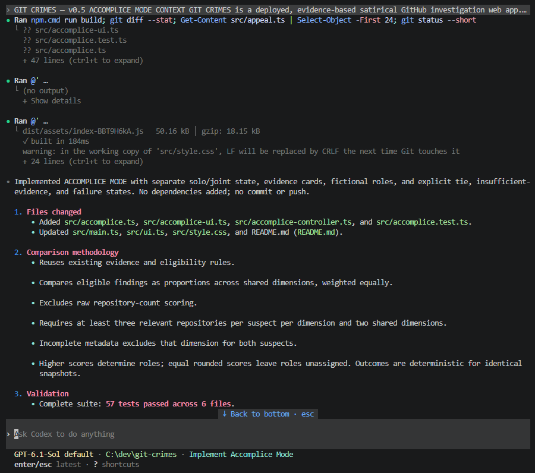
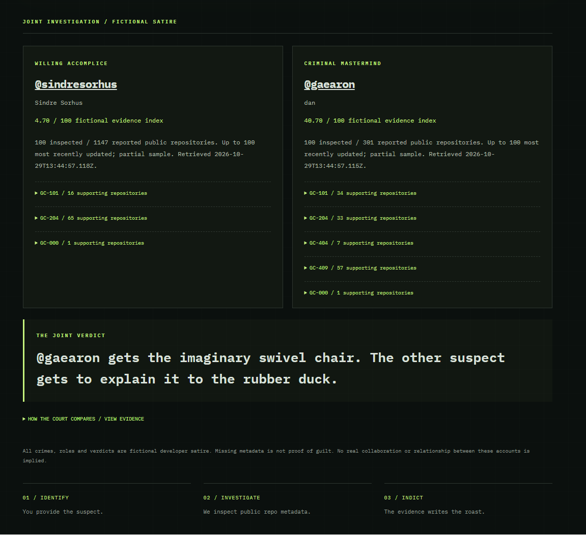
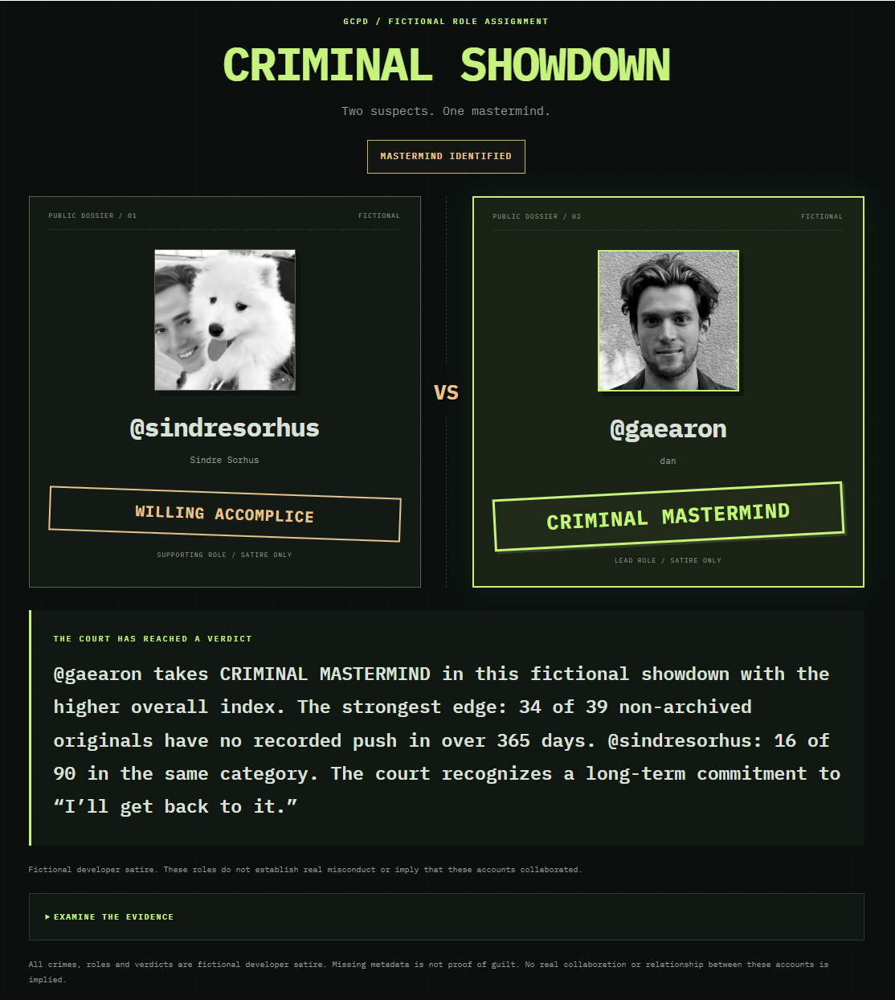

# GIT CRIMES

**Your Commits. Your Crimes. Your Sentence.**

Built during **Codex Build Day Guadalajara 2026** by **GCPD — GitHub Crime Police Department**, with OpenAI Codex.

**[LIVE DEMO](https://git-crimes.pages.dev/) · [WATCH DEMO](https://youtu.be/KwmJT6NzKCs) · [CODEX EVIDENCE](#codex-evidence)**

[Source repository](https://github.com/romangij/git-crimes) · [Try it](#try-the-project) · [Development case study](#how-we-built-it-with-codex) · [Technical information](#technical-information)

Your public GitHub profile is now a crime scene. GIT CRIMES turns public repository metadata into fictional, evidence-backed developer satire: charges, a verdict, and a sentence with receipts. Investigate yourself, appeal with “IT WORKS ON MY MACHINE,” or put two accounts into a CRIMINAL SHOWDOWN. The court is fictional; the repository links are real.

## Codex evidence

**A working feature was only the first verdict. Human review changed the experience.**

- **Initial Codex implementation:** ACCOMPLICE MODE worked; **57 automated tests passed**.
- **Human review:** the interface felt visually flat and was difficult to understand as a showdown.
- **Codex redesign:** large avatars, a VS composition, role stamps, and evidence-aware verdicts made the confrontation clear.
- **Final validation:** **63 automated tests passed**, the production build passed, and the deployed feature was manually verified by the human reviewer.



*Codex CLI development evidence from the event. This capture documents the initial implementation; the before/after case study below shows the subsequent redesign.*

[See the human direction, Codex changes, and before/after screenshots →](#how-we-built-it-with-codex)

## Try the project

Open **[git-crimes.pages.dev](https://git-crimes.pages.dev/)**. No login or token required.

1. **SOLO INVESTIGATION:** enter a public GitHub username, choose a roast intensity, and initiate the investigation. Read the charges and linked receipts, try a PLEA BARGAIN, or export the criminal record as a PNG.
2. **ACCOMPLICE MODE:** enter two distinct public GitHub usernames and select **INVESTIGATE BOTH**. The CRIMINAL SHOWDOWN presents the suspects, fictional roles, and joint verdict. Open **EXAMINE THE EVIDENCE** for the comparison details.

Ties and insufficient comparable evidence leave roles unassigned. These roles do not imply real misconduct or that the accounts actually collaborated. You can switch back to solo without losing its current case.

## Features

| Feature | What you get |
| --- | --- |
| Solo investigations | Public GitHub metadata, six possible fictional charges, linked receipts, verdict, and sentence. Unsupported charges are never added to fill the page. |
| Three roast intensities | FRIENDLY WARNING, FELONY, and UNHINGED change the prosecutor's tone, not the evidence. |
| REISSUE ROAST | Three deterministic editions per intensity, reusing the same evidence with no additional API requests. |
| PNG criminal records | A locally generated 1200 × 630 judicial souvenir with the current principal charge, evidence, verdict, and sentence. |
| PLEA BARGAIN | One appeal per issued solo sentence. Choose a defense and receive an evidence-aware courtroom response; the original ruling stands. |
| ACCOMPLICE MODE | Independent joint state, prominent dossiers and VS matchup, fictional CRIMINAL MASTERMIND / WILLING ACCOMPLICE stamps, and a verdict grounded in comparable findings. |

Joint investigations have no PNG export, intensity controls, or plea bargain in v0.5. The retro terminal interface includes keyboard access, reduced-motion support, and live progress and errors.

## How we built it with Codex

### Human direction and delegated implementation

During Codex Build Day Guadalajara 2026, the human developer directed Codex to add ACCOMPLICE MODE to the existing app: investigate two public accounts, reuse the evidence rules and GitHub client, compare normalized findings, and preserve solo behavior. Constraints included no backend, authentication, database, new dependencies, or unnecessary API endpoints, plus explicit handling of ties, sparse metadata, and partial failures.

Codex implemented the comparison module, isolated joint session and UI, failure handling, tests, and documentation. The initial result passed **57 tests** and a production build. It was functional, but the human browser review identified a product problem that passing tests did not catch.

### Before: correct data, weak confrontation



*Before: the result read like a data comparison. Roles were easy to miss, technical details dominated, and the verdict did little to explain the outcome.*

The human reviewer requested a **CRIMINAL SHOWDOWN**: large avatars and usernames, a strong VS separator, an unmistakable mastermind stamp, the verdict immediately after the matchup, and technical evidence behind a collapsed panel. The scoring algorithm was to remain unchanged. The comedy needed to explain the result using actual findings rather than a generic one-liner.

### After: a showdown with receipts



*After: the fictional outcome is readable before opening the evidence panel. The verdict contrasts observed proportions and delivers a finding-specific developer punchline.*

Codex implemented the revised joint rendering and responsive styling, safe public-avatar handling with initials as a fallback, and a separate verdict-copy module. The verdict selects the largest positive contribution to the existing fictional index among comparable dimensions; it does not introduce another scoring system. Ties and insufficient evidence get clear outcomes without assigning a mastermind.

**The division of work:** the human set the constraints, tried the interface, identified the UX failure, and supplied corrective design and comedy direction. Codex implemented those changes and added focused tests. The human then manually verified the deployed feature. The screenshots document that iteration; they are not a claim that Codex independently judged the product ready.

### Validation and review

- **Initial implementation:** 57 passing automated tests and a passing production build.
- **After redesign:** 63 passing automated tests and a passing production build, including TypeScript checking.
- **Coverage:** normalized comparisons, deterministic roles, ties, insufficient evidence, different sample sizes, incomplete metadata, API failures, solo isolation, safe rendering, verdict facts, and the collapsed evidence layout, alongside existing solo, appeal, and export tests.
- **Human verification:** manual review exposed the initial UX problem; the deployed redesign was subsequently verified. Automated tests do not replace browser layout, accessibility, image-loading, or real-network checks, and this is not a claim of exhaustive cross-browser testing.

## Technical information

### Stack and local development

TypeScript, Vite, plain HTML/CSS, browser Canvas for PNG export, and Vitest for tests. GitHub's public REST API supplies metadata. Humor uses curated deterministic templates; there is no runtime OpenAI API or other AI service. **Codex was the development tool.**

Requires npm and Node.js 22.12+ within 22.x, 24.x, or 26+.

```sh
npm install
npm run dev      # Open the Vite URL, normally http://localhost:5173
npm test         # Full automated suite
npm run build    # TypeScript check and production bundle
npm run preview  # Serve the production build locally
```

### Architecture

| Responsibility | Files |
| --- | --- |
| Public API requests, progress, and errors | `src/github.ts`, `src/types.ts` |
| Evidence and charge eligibility | `src/evidence.ts`, `src/eligibility.ts` |
| Solo templates, intensity, records, and session | `src/humor.ts`, `src/intensity.ts`, `src/charges.ts`, `src/session.ts` |
| Appeals and local PNG generation | `src/appeal.ts`, `src/appeal-templates.ts`, `src/export-record.ts` |
| Joint comparison and isolated session | `src/accomplice.ts` |
| Joint presentation and evidence-aware verdict | `src/accomplice-ui.ts`, `src/accomplice-controller.ts`, `src/accomplice-verdict.ts` |
| App lifecycle, solo rendering, and styles | `src/main.ts`, `src/ui.ts`, `src/style.css` |

Tests live beside the modules in `src/*.test.ts`. Evidence analysis takes an explicit clock. Presentation changes reuse snapshots; only new investigations fetch profile/repository evidence. Solo and joint cases are retained separately in memory and disappear on reload.

### Evidence and comparison rules

Rules apply to the inspected sample. Forks are excluded from original-repository rules.

| Fictional charge | Eligibility | Joint denominator |
| --- | --- | --- |
| Repository Abandonment | At least 1 non-archived original with a recorded push older than 365 days | Non-archived originals |
| JavaScript Allegiance | At least 3 originals with JavaScript or TypeScript as the primary language | Originals |
| Serial Repository Creation | At least 10 originals | Excluded from joint scoring |
| Description Negligence | At least 3 originals with absent or blank descriptions | Originals |
| Excessive Fork Possession | At least 5 forks | All inspected repositories |
| Empty Promise | At least 1 original reporting 0 KB | Originals |

The joint index is `100 * mean(eligible findings / relevant repositories)`, equally weighted across shared dimensions and rounded to two decimal places. Below-threshold findings contribute zero. Each dimension requires at least **3 relevant repositories per account**, complete relevant metadata on both sides, and at least **2 shared dimensions** overall. Raw repository-count scoring is excluded. Higher displayed indices assign fictional roles; ties and insufficient evidence leave them unassigned. Insufficient evidence also withholds scores.

Unknown metadata excludes a dimension for both suspects: unknown fork flags exclude all dimensions; unknown archive flags exclude staleness; null/invalid push dates, null languages, omitted descriptions, and missing/invalid sizes exclude their respective dimensions. Explicit `null` descriptions mean no description; omitted descriptions are unknown. Unknown values are removed before joint charge eligibility is evaluated.

Both suspects use the later retrieval timestamp as a common staleness clock. Identical snapshots and clock produce deterministic outcomes independent of input order. This is a satire heuristic, not a confidence estimate or developer-skill ranking: thresholds create discontinuities, and samples may differ in size, coverage, and composition.

### API limits, privacy, and boundaries

- **Public data only:** no OAuth, tokens, backend, database, or private-repository access. Only public profile and repository metadata are inspected; no files, README content, dependencies, or commit histories are fetched.
- **Bounded requests:** one profile and one page of up to 100 most recently updated owned public repositories, including forks, per account. A successful solo investigation uses two requests; a joint investigation uses four. No pagination. Coverage is disclosed; metadata and profile counts can change between requests.
- **Failures stay explicit:** missing accounts, network failures, timeouts, and access/rate restrictions show errors. Both joint investigations must succeed before a verdict appears. Duplicate names and aliases resolving to one account are rejected; partial failures require retrying both accounts.
- **Rate limits:** unauthenticated GitHub access commonly allows 60 requests per hour per IP; shared event Wi-Fi can exhaust it. Each request has a 15-second timeout.
- **No invented conclusions:** stale repositories can be completed projects; a missing description is not missing documentation; 0 KB does not prove there are no files. Missing metadata is not guilt. Fictional roles imply no real relationship or collaboration.
- **Local state and export:** the app does not upload or persist investigation results. PNGs are generated locally from the clicked solo snapshot and include one principal charge, not every receipt. Avatar requests go to GitHub; public text is escaped and outgoing URLs restricted. Optional Google Fonts falls back to local monospace fonts; internet access is required for investigations.
- **Export limits:** blocked/missing avatars fall back to a silhouette in PNGs; export retries without an image on canvas security failure. Export avatar loading uses anonymous CORS and a four-second timeout. Text is measured rather than silently truncated; layout failures show an error. Fonts and browser download/save behavior can vary, particularly on mobile.
- **Finite humor:** three editions per solo intensity repeat by design. Changing intensity or reissuing resets the appeal; selecting the same intensity does not. Successful new solo investigations reset it; failed investigations do not issue a new sentence. Appeals never change evidence, verdict, sentence, or PNG content.

### Manual browser checks

Try solo intensity changes, reissuing, appeals, and PNG export; then switch to joint mode and back to confirm state isolation. Check a winner in either position, equal and insufficient evidence, long usernames, unavailable avatars, and invalid/duplicate accounts. Use network tools to simulate a blocked repository request or a 403/429 response and confirm there is no partial verdict. Check mobile layout, keyboard focus, the evidence disclosure, reduced motion, and download behavior in your target browsers.

Broader pagination, persistent archives, sharing, and an optional AI roast engine remain future ideas, not implemented features.

---

All charges, roles, verdicts, and sentences are fictional developer satire. **Public evidence. Questionable justice.**
